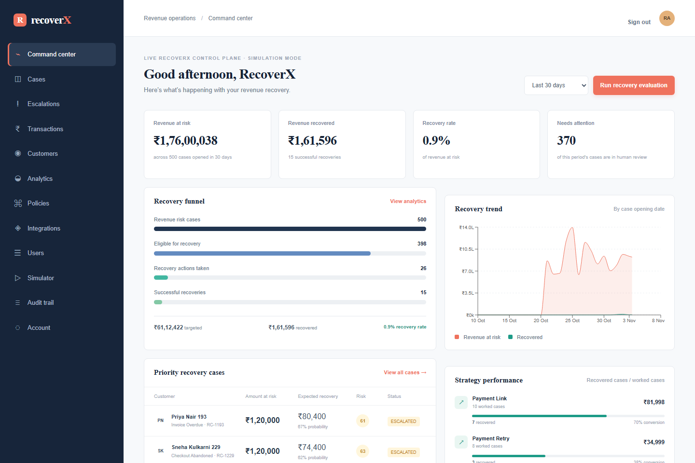
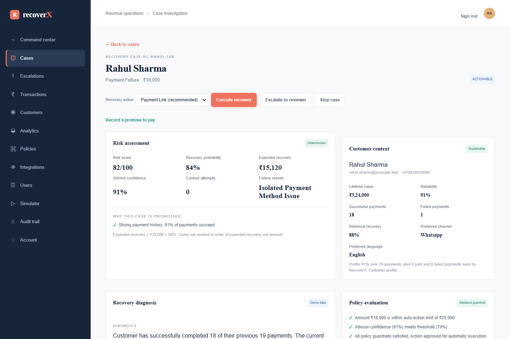
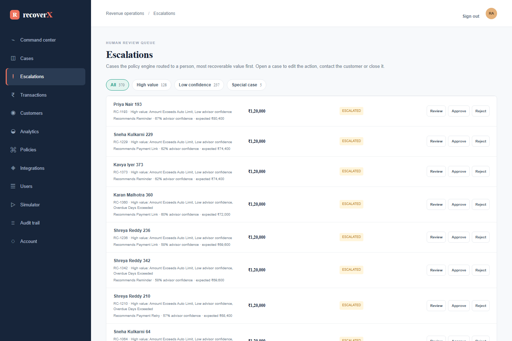
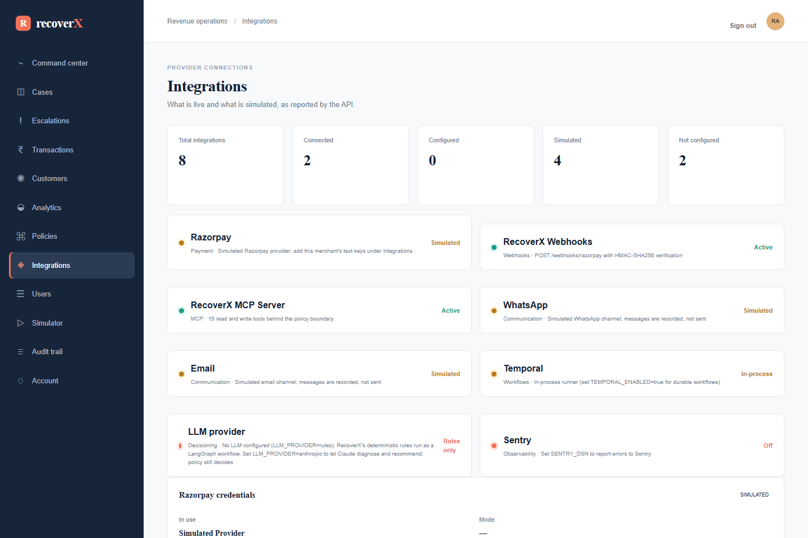
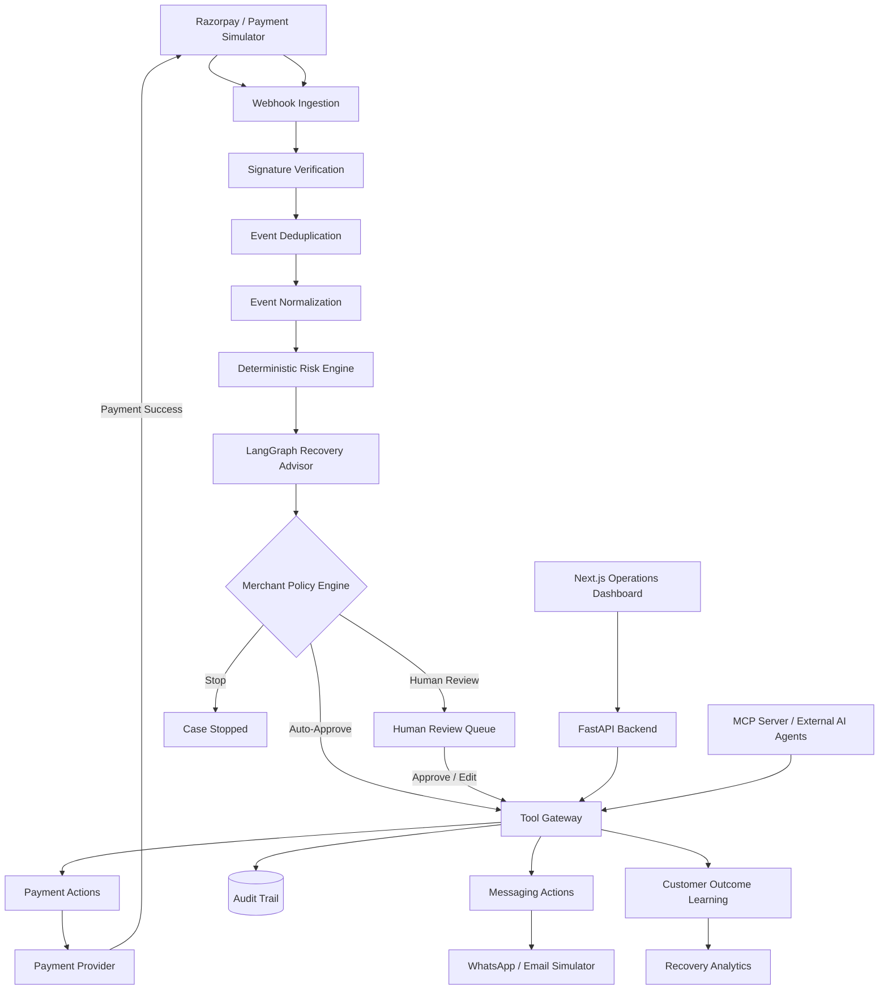

# RecoverX – Revenue Leakage Detection and Automated Recovery System

**An AI-assisted revenue recovery and payment intelligence platform for Razorpay merchants.**

RecoverX is a revenue recovery control plane designed to identify, prioritize, and automate the resolution of failed payments, overdue invoices, halted subscriptions, and abandoned checkouts.

The platform combines deterministic risk assessment, AI-assisted recovery recommendations, merchant-defined policy enforcement, and controlled action execution to help businesses recover lost revenue while maintaining operational oversight, security, and accountability.

Every recovery case follows a structured workflow: event ingestion, risk assessment, strategy recommendation, policy validation, controlled execution, and outcome tracking.



---

## Overview

Revenue leakage occurs when expected payments fail to materialize due to declined transactions, unsuccessful subscription renewals, overdue invoices, or abandoned checkouts.

Managing these cases manually becomes increasingly difficult as transaction volumes grow. Unrestricted automation can introduce additional risks, including duplicate payment attempts, unauthorized customer communication, violations of merchant policies, and insufficient auditability.

RecoverX addresses these challenges through a centralized recovery workflow that combines automation with deterministic controls and human oversight.

### Core Capabilities

- **Payment Event Ingestion:** Processes signed Razorpay webhooks and normalizes payment events into a canonical revenue event format.
- **Revenue Leakage Detection:** Identifies and tracks failed payments, overdue invoices, halted subscriptions, and abandoned checkouts.
- **Risk-Based Prioritization:** Calculates risk scores, recovery probabilities, and expected recovery values to prioritize cases.
- **AI-Assisted Recovery Recommendations:** Uses LangGraph to analyze recovery cases and recommend appropriate actions.
- **Policy-Driven Automation:** Enforces merchant-defined thresholds, confidence requirements, contact restrictions, and approval rules.
- **Controlled Action Execution:** Routes all payment and messaging operations through a centralized, audited Tool Gateway.
- **Human-in-the-Loop Review:** Escalates sensitive or uncertain cases for authorized human approval.
- **Recovery Lifecycle Management:** Supports promises to pay, scheduled follow-ups, reminders, and case expiry.
- **Outcome-Based Learning:** Updates customer recovery statistics and action effectiveness based on completed cases.
- **MCP Integration:** Exposes recovery capabilities through a Model Context Protocol server for external AI agents.
- **Failure Simulation and Evaluation:** Tests recovery workflows under simulated failures and evaluates policy compliance and recovery outcomes.
- **Operational Analytics:** Provides dashboards for revenue recovery, transaction monitoring, customer management, and audit inspection.

---

## Key Features

### 1. Webhook Ingestion and Event Processing

RecoverX supports secure ingestion of payment events from Razorpay.

The ingestion pipeline includes:

- HMAC-SHA256 signature verification using merchant-specific webhook secrets.
- Replay-safe event deduplication using event identifiers.
- Normalization of provider-specific events into a canonical internal event representation.
- Currency conversion from paise to rupees.
- Processing of payment failures and successful payment events.
- Structured event handling for downstream recovery workflows.

This provides a consistent foundation for processing payment events and initiating recovery cases.

### 2. Deterministic Risk Assessment

The risk engine evaluates recovery cases using customer payment history and case-level information.

It calculates:

- Recovery risk score.
- Estimated probability of successful recovery.
- Expected recovery value.

Cases are prioritized using expected recovery value rather than transaction amount alone.

This allows the system to focus recovery efforts on cases with stronger estimated recovery potential.

### 3. AI-Assisted Recovery Advisor

RecoverX integrates **LangGraph** to provide structured recovery recommendations.

The advisor analyzes recovery cases and recommends an appropriate recovery action based on the available case context.

The recommendation pipeline includes:

1. Case context preparation.
2. Recovery strategy recommendation.
3. Strict schema validation of AI-generated output.
4. A single retry when the generated output is invalid.
5. Fail-safe escalation to human review if validation fails.

The advisor operates using RecoverX's deterministic, rules-based recovery logic.

**AI is restricted to recommendation generation. It does not authorize actions, calculate financial amounts, or directly execute payment operations.**

### 4. Merchant Policy Engine

The policy engine evaluates proposed recovery actions against merchant-configured rules.

Policy conditions include:

- Maximum permitted transaction amount.
- Minimum confidence thresholds.
- Customer contact limits.
- Payment and case aging restrictions.
- Customer communication opt-outs.
- Permitted communication channels.
- Supported languages.
- Allowed recovery actions.

Based on the evaluation, the system assigns one of three outcomes:

| Decision | Description |
|---|---|
| Auto-Approve | Action satisfies the merchant's configured automation policy. |
| Human Review | Action requires authorized human intervention. |
| Stop | Action violates policy or cannot proceed safely. |

Policy validation is enforced again at execution time rather than relying exclusively on the advisor's recommendation.

### 5. Centralized Tool Gateway

The Tool Gateway acts as the single controlled execution layer for payment and messaging operations.

All consequential actions, whether initiated by the advisor, an operator, or an external AI agent, pass through this gateway.

Its responsibilities include:

- Execution-time policy validation.
- Idempotency enforcement.
- Controlled interaction with payment and messaging providers.
- Action authorization.
- Audit event generation.
- Consistent execution handling across different application interfaces.

This architecture separates decision-making from action execution and prevents AI recommendations from directly triggering external operations.

### 6. Human-in-the-Loop Recovery Management

Cases requiring intervention are routed into dedicated review queues.

Review categories include:

- High-value recovery cases.
- Low-confidence recommendations.
- Missed payment promises.
- Customer contact limit violations.
- Explicitly requested reviews.

Authorized reviewers can:

- Approve recommended recovery actions.
- Modify proposed actions.
- Contact customers.
- Reject recovery recommendations.
- Close recovery cases.

This provides operational oversight for decisions that should not be fully automated.

### 7. Promise-to-Pay and Recovery Workflows

RecoverX supports structured payment commitment tracking.

Customers can submit a promised payment date, after which the system manages scheduled follow-ups and escalations.

Workflow functionality includes:

- Promise-to-pay tracking.
- Scheduled customer reminders.
- Follow-up execution.
- Escalation for missed commitments.
- Automatic case expiry.
- Temporal-based durable workflows or an hourly scheduled job.

### 8. Recovery Outcome Learning

The system tracks completed recovery outcomes to improve subsequent customer-level decisions.

Closed recovery cases update customer recovery statistics, including historical recovery rates and action effectiveness.

This information contributes to future recovery prioritization and recommendation decisions.

### 9. Model Context Protocol (MCP) Integration

RecoverX includes an MCP server that exposes recovery functionality to compatible external AI agents.

**Implementation details:**

- JSON-RPC communication.
- Streamable HTTP transport.
- 15 exposed tools.
- 10 read operations.
- 5 write operations.

MCP operations follow the same role-based authorization, tenant isolation, and policy enforcement requirements as the primary application.

### 10. Failure Lab and Evaluation Framework

The Failure Lab provides a controlled environment for testing recovery scenarios through the actual application pipeline.

Supported simulation scenarios include:

- Payment provider timeouts.
- Invalid AI-generated recommendations.
- Low-confidence decisions.
- Customer communication opt-outs.
- Contact limit violations.
- Missed payment promises.

A batch evaluation process replays recovery cases and reports:

- Policy violations.
- False escalations.
- Recovered revenue.
- Recovery workflow outcomes.

This helps assess system behavior under both normal and exceptional operating conditions.

### 11. Operational Dashboard

The Next.js application provides a centralized interface for managing revenue recovery operations.

Major application areas include:

- Command Center.
- Recovery case investigation.
- Human review and escalation queues.
- Transaction monitoring.
- Customer management.
- CSV customer import.
- Revenue analytics.
- Merchant policy configuration.
- Payment and messaging integrations.
- User and role management.
- Audit trail inspection.
- Failure simulation.

---

## Screenshots

### Recovery Case Investigation and Human Review

| Case Investigation | Human Review Queue |
|---|---|
|  |  |

### Integration Management



*Screenshots use the built-in synthetic demonstration dataset. No real customer data is displayed.*

---

## Technology Stack

| Layer | Technologies |
|---|---|
| Backend | Python 3.13, FastAPI |
| ORM and Database Migrations | SQLAlchemy 2, Alembic |
| Data Validation | Pydantic 2 |
| AI and Workflow Orchestration | LangGraph, Temporal SDK |
| Database | PostgreSQL, SQLite |
| Frontend | Next.js 16, React 19 |
| Programming Languages | Python, TypeScript, JavaScript |
| UI and Styling | Tailwind CSS 4 |
| Data Visualization | Recharts |
| API Integration | REST APIs, JSON-RPC, MCP |
| Testing | pytest, Playwright |
| Code Quality | Ruff, ESLint, Prettier |
| CI/CD | GitHub Actions |
| Containerization | Docker, Docker Compose |
| Deployment | Render |
| Monitoring and Logging | Structured JSON logging, optional Sentry |

---

## System Architecture

RecoverX follows a **modular monolithic architecture** built around a layered FastAPI backend, a PostgreSQL database, and a Next.js frontend.

The backend separates HTTP handling, application orchestration, business rules, and infrastructure integrations.

### High-Level Architecture



### Architectural Layers

| Layer | Responsibility |
|---|---|
| API | HTTP routes, request validation, authentication middleware, MCP endpoints, and response handling. |
| Application | Recovery use cases, webhook processing, orchestration, case management, and execution workflows. |
| Domain | Core business rules, risk calculations, policies, decisions, events, and recovery logic. |
| Infrastructure | Database access, payment provider integrations, messaging adapters, LangGraph advisor, and Temporal workflows. |
| Core | Application configuration, security utilities, encryption, and structured logging. |

### Core Design Principles

**Separation of recommendation and authorization**

The AI advisor recommends recovery actions. The deterministic policy engine decides whether an action is permitted. Only the Tool Gateway executes consequential operations.

**Financial integrity**

Financial amounts are derived from persisted records and payment provider events rather than AI-generated values.

**Idempotent execution**

Repeated events and requests are handled through deduplication and idempotency controls to prevent unintended duplicate operations.

**Tenant isolation**

Database queries and application operations are scoped to the authenticated merchant.

**Controlled case transitions**

Recovered, stopped, or expired cases cannot be reopened by operators or agents. A genuine payment event is required to transition a case into the recovered state.

**Auditability**

Consequential decisions and changes generate audit events, supporting operational traceability.

For additional architectural information, see [docs/ARCHITECTURE.md](docs/ARCHITECTURE.md).

---

## Repository Structure

```text
Revenue-Leakage-Detection-and-Automated-Recovery-System/
│
├── backend/
│   ├── app/
│   │   ├── api/
│   │   │   ├── HTTP routes
│   │   │   ├── Request and response schemas
│   │   │   ├── MCP server
│   │   │   ├── Middleware
│   │   │   └── Error handling
│   │   │
│   │   ├── application/
│   │   │   ├── Webhook ingestion
│   │   │   ├── Recovery case management
│   │   │   ├── Tool Gateway
│   │   │   ├── Simulation
│   │   │   ├── Outcome learning
│   │   │   └── Workflows
│   │   │
│   │   ├── domain/
│   │   │   ├── Risk assessment
│   │   │   ├── Policy engine
│   │   │   ├── Events
│   │   │   ├── Decisions
│   │   │   └── Messaging rules
│   │   │
│   │   ├── infrastructure/
│   │   │   ├── Database
│   │   │   ├── Razorpay integration
│   │   │   ├── Simulated providers
│   │   │   ├── Messaging adapters
│   │   │   ├── LangGraph advisor
│   │   │   └── Temporal workflows
│   │   │
│   │   └── core/
│   │       ├── Configuration
│   │       ├── Logging
│   │       ├── Security
│   │       └── Encryption
│   │
│   ├── alembic/
│   │   └── Database migrations
│   │
│   ├── scripts/
│   │   ├── Seed data
│   │   ├── Hourly jobs
│   │   ├── Batch evaluation
│   │   └── Razorpay test round trip
│   │
│   ├── tests/
│   │   └── Unit and integration tests
│   │
│   └── requirements-dev.txt
│
├── frontend/
│   ├── src/
│   │   ├── app/
│   │   ├── features/
│   │   └── services/
│   │       └── api/
│   │
│   ├── e2e/
│   │   └── Playwright end-to-end tests
│   │
│   └── package.json
│
├── docs/
│   ├── screenshots/
│   ├── ARCHITECTURE.md
│   ├── API.md
│   ├── AI.md
│   ├── MCP.md
│   ├── DEVELOPMENT.md
│   ├── DEPLOYMENT.md
│   └── ENVIRONMENT.md
│
├── docker-compose.yml
├── render.yaml
├── .env.example
├── .env.production.example
└── README.md
```

---

## Getting Started

RecoverX can be executed locally using Docker Compose or by running the backend and frontend independently.

### Prerequisites

- Python 3.13
- Node.js 22+
- npm
- Git
- Docker and Docker Compose (for containerized execution)

### Option 1: Run Using Docker

Clone the repository:

```bash
git clone https://github.com/sritejaswini15/Revenue-Leakage-Detection-and-Automated-Recovery-System.git

cd Revenue-Leakage-Detection-and-Automated-Recovery-System
```

Build and start the application:

```bash
docker compose up --build
```

Docker Compose starts the configured application services, including PostgreSQL, the FastAPI backend, and the Next.js frontend.

### Option 2: Run Without Docker

**Step 1: Clone the repository**

```bash
git clone https://github.com/sritejaswini15/Revenue-Leakage-Detection-and-Automated-Recovery-System.git

cd Revenue-Leakage-Detection-and-Automated-Recovery-System
```

**Step 2: Set up the Python environment**

```bash
python -m venv .venv
```

Activate the environment:

Windows PowerShell:

```powershell
.venv\Scripts\Activate.ps1
```

macOS / Linux:

```bash
source .venv/bin/activate
```

**Step 3: Install backend dependencies**

```bash
pip install -r backend/requirements-dev.txt
```

**Step 4: Start the backend**

```bash
cd backend
uvicorn app.main:app --reload
```

The backend API will be available at:

```text
http://localhost:8000
```

Interactive API documentation:

```text
http://localhost:8000/docs
```

**Step 5: Start the frontend**

Open a second terminal:

```bash
cd frontend
npm ci
npm run dev
```

The frontend will be available at:

```text
http://localhost:3000
```

---

## Demo Environment

On initial startup, RecoverX initializes a deterministic demonstration merchant containing:

- 1,000 synthetic customers.
- 500 recovery cases.
- Demonstration accounts for different application roles.

### Demo Credentials

| Role | Email |
|---|---|
| Administrator | `admin@recoverx.local` |
| Finance | `finance@recoverx.local` |
| Operator | `operator@recoverx.local` |
| Viewer | `viewer@recoverx.local` |

**Demonstration password:** `recoverx-demo`

These credentials are intended exclusively for local demonstration. Demo accounts are not created in production environments.

### Exploring the Recovery Workflow

To explore the application's functionality:

1. Sign in using a demonstration account.
2. Open the Command Center to examine recovery metrics.
3. Navigate to the Simulator to generate payment and recovery scenarios.
4. Open a recovery case to inspect its risk assessment and recommended strategy.
5. Use Execute Recovery to initiate the simulated payment-link workflow.
6. Open the customer payment page associated with the case.
7. Complete the simulated payment to trigger recovery processing.
8. Return to the dashboard to observe the updated case status and recovery analytics.

This workflow demonstrates the complete recovery lifecycle through the application's actual processing pipeline.

---

## Environment Configuration

RecoverX provides local defaults for its configuration settings. Production environments require explicitly configured secrets and service credentials.

| Variable | Description |
|---|---|
| `DATABASE_URL` | Database connection string. PostgreSQL for deployment; SQLite when unset. |
| `AUTH_SECRET` | Application authentication and session signing secret. |
| `CREDENTIALS_ENCRYPTION_KEY` | Encryption key for stored merchant credentials. |
| `RAZORPAY_WEBHOOK_SECRET` | Secret used for webhook signature verification. |
| `BOOTSTRAP_RAZORPAY_ACCOUNT_ID` | Default Razorpay account routing configuration. |
| `PAYMENT_PROVIDER` | Selects `simulated` or `razorpay` payment processing. |
| `TEMPORAL_ENABLED` | Enables Temporal-based durable workflows. |
| `SENTRY_DSN` | Optional Sentry error monitoring configuration. |
| `LOG_FORMAT` | Configures structured logging output. |

Environment templates:

- [.env.example](.env.example)
- [.env.production.example](.env.production.example)

For the complete configuration reference, see [docs/ENVIRONMENT.md](docs/ENVIRONMENT.md).

**Security note:** Never commit API keys, webhook secrets, encryption keys, or production credentials to version control. Production configuration must use secure environment variables or a secrets management solution.

---

## Security Architecture

Security is implemented across authentication, authorization, tenant isolation, event ingestion, and action execution.

| Security Control | Implementation |
|---|---|
| Authentication | HttpOnly session cookies |
| CSRF Protection | CSRF validation |
| Authorization | Four server-enforced application roles |
| Tenant Isolation | Merchant-scoped data access |
| Webhook Security | HMAC-SHA256 signature verification |
| Replay Protection | Event deduplication and idempotency |
| Credential Protection | Encrypted merchant credentials |
| Login Security | Login throttling |
| Application Security | Security response headers |
| Auditability | Structured audit events |
| Logging | Request IDs and redacted logs |

The application enforces authorization at the backend rather than relying on frontend visibility or client-side restrictions.

---

## Testing and Code Quality

RecoverX includes automated backend and frontend validation.

### Backend Tests

Run the backend test suite:

```bash
cd backend
pytest
```

The backend test suite covers:

- Payment event ingestion.
- Risk assessment and policy evaluation.
- Recovery case lifecycle.
- Tool Gateway execution.
- Tenant isolation.
- Authentication and authorization.
- Idempotency under repeated and concurrent requests.
- MCP protocol behavior.
- AI advisor schema validation.
- Retry and fail-safe escalation behavior.
- Recovery outcome processing.

PostgreSQL testing can be configured using `TEST_DATABASE_URL`.

### Backend Code Quality

```bash
cd backend

ruff check .
ruff format --check .
```

### Frontend Validation

```bash
cd frontend

npm run lint
npm run typecheck
npm run build
```

### End-to-End Testing

With the API and frontend running:

```bash
cd frontend
npm run e2e
```

Playwright tests validate important application workflows through the browser.

### Current Test Coverage

At the documented project revision:

| Test Category | Tests |
|---|---:|
| Backend unit and integration tests | 312 |
| Playwright end-to-end tests | 19 |
| Total | 331 |

The test suites include an end-to-end recovery trace, tenant isolation checks, idempotency validation, MCP behavior, and AI recommendation failure handling.

### Continuous Integration

GitHub Actions automates project validation through:

- Backend test execution on SQLite and PostgreSQL.
- Database migration consistency checks.
- Python linting and formatting checks.
- Frontend linting.
- Type checking.
- Production build validation.
- Playwright end-to-end testing.

---

## Deployment

RecoverX includes a Render Blueprint configuration through `render.yaml`.

The deployment configuration provisions:

- PostgreSQL database.
- FastAPI backend service.
- Next.js frontend service.
- Scheduled hourly job for follow-ups and case expiry.

The backend performs database migrations during startup and exposes a health-check endpoint at:

```text
/health
```

Production secrets are configured through the Render dashboard rather than committed to the repository.

Refer to [docs/DEPLOYMENT.md](docs/DEPLOYMENT.md) for deployment instructions, Razorpay webhook configuration, optional Temporal integration, and production readiness considerations.

---

## Integration Status and Implementation Scope

RecoverX distinguishes between implemented application functionality and integrations that have been verified against external services.

| Integration | Implementation Status |
|---|---|
| Webhook ingestion and verification | Implemented and tested |
| Deterministic risk engine | Implemented and tested |
| Rules-based recovery advisor | Implemented and tested |
| Merchant policy engine | Implemented and tested |
| Tool Gateway | Implemented and tested |
| Human review workflows | Implemented and tested |
| Promise-to-pay and follow-ups | Implemented |
| Recovery outcome learning | Implemented |
| Audit trail and analytics | Implemented |
| MCP server | Implemented and tested |
| Razorpay | Simulated by default; REST client for test keys implemented and unit-tested, but not verified against a real Razorpay account |
| WhatsApp and Email | Simulated; messages are stored rather than delivered |
| Temporal | Workflow and worker implementations exist; real Temporal server execution has not been verified |
| Sentry | Configured but not tested against a live project |

The Integrations page also reports integration status at runtime.

---

## Current Limitations

- External WhatsApp and email delivery providers are not yet integrated.
- Razorpay integration requires verification against an actual test-mode merchant account before production use.
- Temporal workflows require validation against a running Temporal server.
- Sentry integration has not been exercised against a live monitoring project.
- Frontend functionality is covered by static validation and Playwright end-to-end tests; dedicated frontend unit tests are not currently included.

These limitations are documented to distinguish tested functionality from integrations that still require external service validation.

---

## Future Enhancements

Potential areas for further development include:

- Integration with WhatsApp Business and production email providers.
- Verified Razorpay test-mode payment workflows and subsequent live-mode readiness.
- Evaluation of the recovery advisor against a labeled dataset.
- Dedicated Temporal worker deployment for durable multi-day recovery workflows.
- Expanded recovery analytics and financial reporting.
- Frontend component-level unit testing.
- Accessibility validation and interface improvements.
- Additional payment gateway integrations.

---

## Documentation

Detailed technical documentation is available in the `docs/` directory.

| Document | Description |
|---|---|
| [Architecture](docs/ARCHITECTURE.md) | System architecture, components, and design decisions. |
| [API Documentation](docs/API.md) | Backend API endpoints and request/response specifications. |
| [AI Advisor](docs/AI.md) | Recovery advisor implementation and validation. |
| [MCP Integration](docs/MCP.md) | MCP server, transport, and exposed tools. |
| [Development Guide](docs/DEVELOPMENT.md) | Local development and contribution workflow. |
| [Deployment Guide](docs/DEPLOYMENT.md) | Deployment configuration and production setup. |
| [Environment Reference](docs/ENVIRONMENT.md) | Application environment variables and configuration. |

---

## Project Information

**Project:** RecoverX – Revenue Leakage Detection and Automated Recovery System

**Domain:** FinTech, Revenue Operations, Payment Automation, AI-Assisted Decision Systems

**Architecture:** Modular Monolith

**Backend:** Python, FastAPI

**Frontend:** Next.js, React, TypeScript

**AI Orchestration:** LangGraph

**Workflow Orchestration:** Temporal

**Payment Integration:** Razorpay

---

**RecoverX demonstrates the application of backend engineering, financial workflow automation, deterministic decision systems, AI-assisted recommendations, and secure payment operations to the problem of revenue leakage and recovery.**
