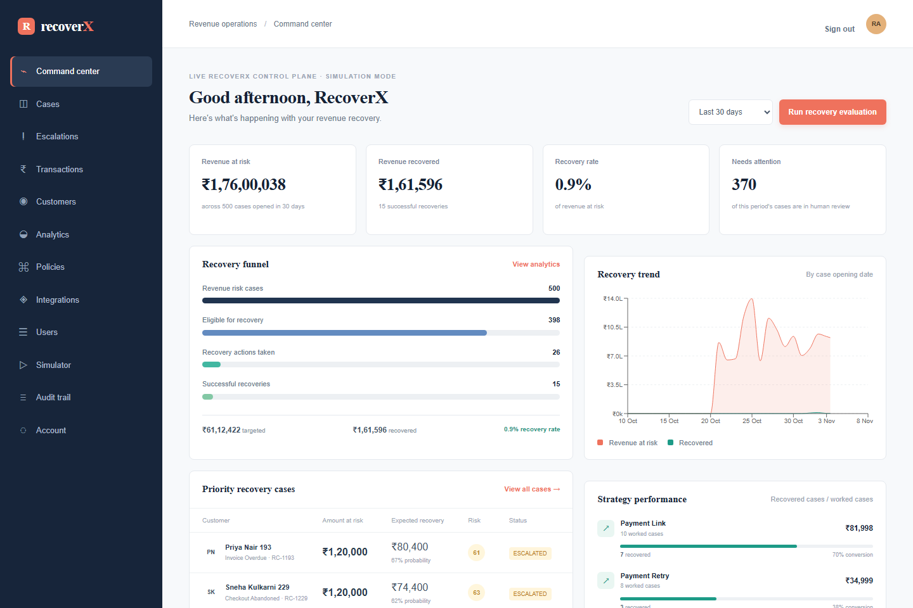
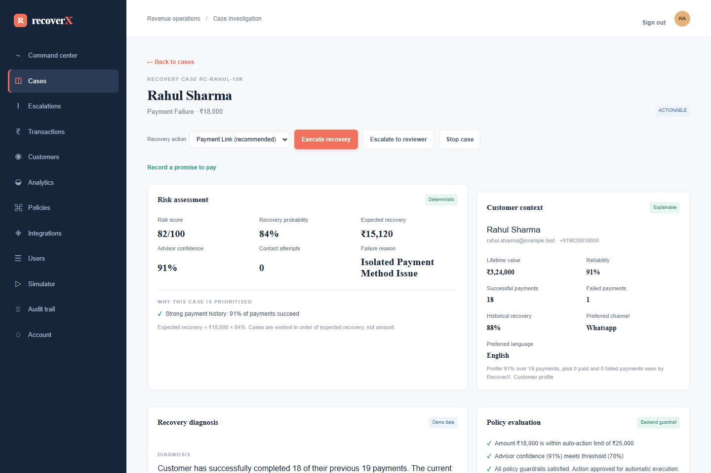
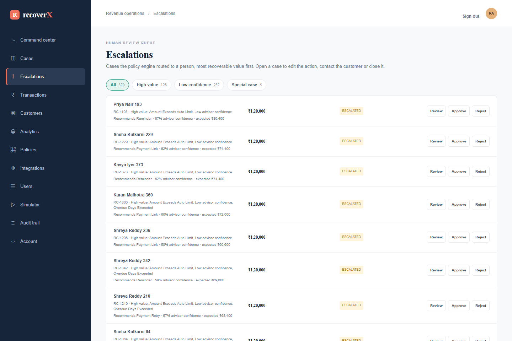
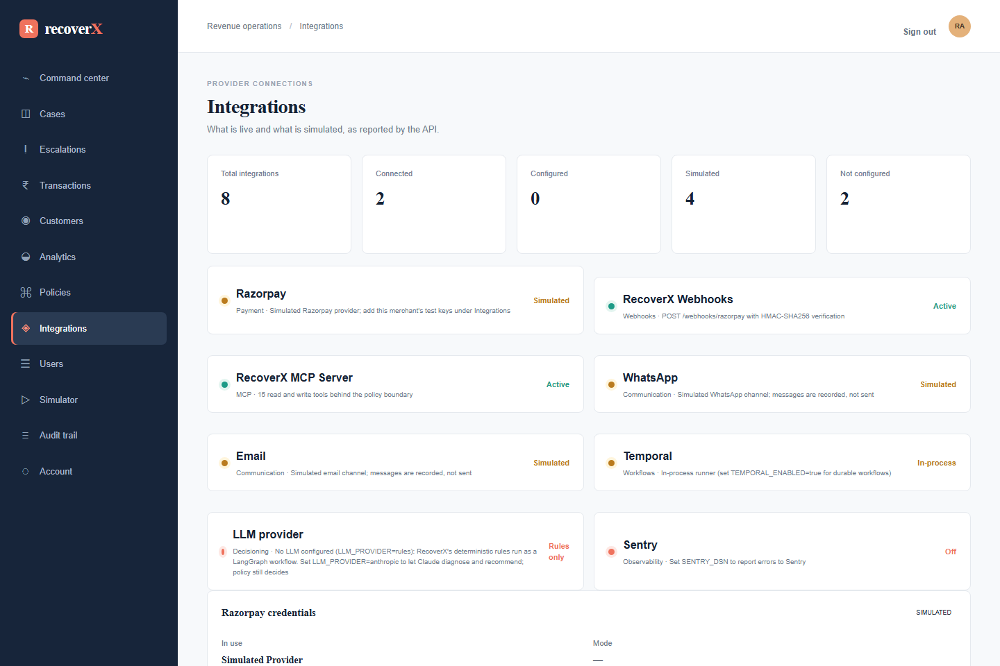
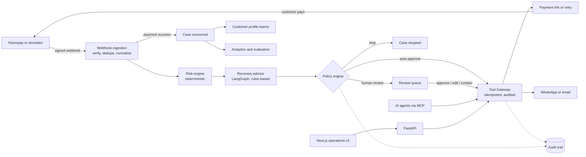

# RecoverX

**An AI-assisted revenue recovery control plane for Razorpay merchants.** RecoverX turns failed payments, halted subscriptions, overdue invoices and abandoned checkouts into tracked recovery cases. It scores each case, has an advisor recommend a strategy, checks that strategy against the merchant's own policy, acts through a single audited gateway, and measures the money that comes back.



## The problem

A share of every merchant's revenue never arrives: a card is declined, a UPI mandate fails, an invoice slips past its due date, a customer abandons a checkout. Chasing it by hand doesn't scale, and fully automatic dunning creates new risks. It can message customers who opted out, act on large amounts without anyone looking, retry a payment twice, or leave no record of who decided what.

RecoverX automates the routine recoveries and keeps people in control of the rest. Every action passes a deterministic policy check, every decision is explained, and every step is written to an audit trail.

## Features

- **Signed webhook ingestion.** HMAC-SHA256 verification per merchant, replay-safe deduplication by event id, and normalization of Razorpay events into one canonical revenue event (paise → rupees).
- **Deterministic risk engine.** Risk score, recovery probability and expected recovery value from the customer's history. Cases are worked in order of expected recovery, not amount.
- **Recovery advisor (LangGraph).** Diagnoses each case and recommends one action. Its output is validated against a strict schema, retried once if invalid, then fails safe to human review. It runs on RecoverX's deterministic, rules-based logic. The advisor only recommends; it never authorizes or computes money.
- **Merchant policy engine.** Amount limits, a confidence floor, contact limits, aging and opt-outs decide between *auto-approve*, *human review* and *stop*. The merchant's channels, languages and allowed actions are enforced at execution time.
- **Tool Gateway.** The single path to every payment and messaging action. It re-checks policy, enforces idempotency and writes the audit trail, whoever asks: the advisor, an operator or an AI agent.
- **Human review queue.** Escalations are sorted into review queues (high value, low confidence, missed promise, contact limit, requested review). Reviewers approve, edit the action, contact the customer, reject or close.
- **Promise-to-pay, follow-ups and expiry.** Customers can promise a date; reminders and escalations follow on schedule (Temporal, or an hourly job); unpaid cases expire.
- **Learning from outcomes.** Each closed case updates the customer's recovery rate and the action that works for them, which feeds the next decision.
- **MCP server.** A Model Context Protocol endpoint (JSON-RPC, Streamable HTTP) exposing 15 tools (10 read, 5 write). They have the same role, tenant and policy checks as the UI.
- **Failure Lab and evaluation.** Simulate provider timeouts, invalid AI output, low confidence, opt-outs, contact limits and promises through the real pipeline. A batch evaluation replays every case and reports policy violations, false escalations and recovered revenue.
- **Operations UI.** Command Center, case investigation with explanations, review queue, transactions, customers (CSV import), analytics, policies, integrations, users and the audit trail.
- **Security.** HttpOnly session cookies with CSRF protection, four roles enforced on the server, per-merchant data isolation, encrypted merchant credentials, login throttling, security headers, request IDs and redacted logs.

## Screenshots

| Case investigation | Human review queue |
|---|---|
|  |  |



*Screenshots use the built-in synthetic demo dataset; no real customer data.*

## Tech stack

| Layer | Technologies |
|---|---|
| Backend | Python 3.13, FastAPI, SQLAlchemy 2, Alembic, Pydantic 2 |
| AI and workflows | LangGraph (rules-based recovery advisor), Temporal SDK (optional durable workflows) |
| Data | PostgreSQL in deployment; SQLite for local development and tests |
| Frontend | Next.js 16 (App Router), React 19, TypeScript, Tailwind CSS 4, Recharts |
| Quality | pytest, Ruff, ESLint, Prettier, Playwright, GitHub Actions (SQLite and PostgreSQL) |
| Operations | Docker, Docker Compose, Render Blueprint, structured JSON logs, optional Sentry |

## Architecture

RecoverX is a modular monolith: one FastAPI service in clean-architecture layers (`api → application → domain ← infrastructure`), one PostgreSQL database and one Next.js app.



**Design invariants**

- The advisor recommends; the policy engine decides; only the Tool Gateway acts.
- Amounts come from persisted records and provider events, never from the AI.
- A recovered, stopped or expired case can't be reopened by a person or an agent; only a real payment moves it.
- Every query is scoped to the caller's merchant, and every consequential change writes an audit event.

More detail is in [docs/ARCHITECTURE.md](docs/ARCHITECTURE.md).

## Project structure

```
backend/
  app/
    api/              HTTP routes, schemas, MCP server, middleware, error mapping
    application/      Use cases: ingestion, cases, Tool Gateway, simulation, learning, workflows
    domain/           Pure business rules: risk, policy, events, decisions, messages
    infrastructure/   Database, Razorpay and simulated providers, messaging, LangGraph advisor, Temporal
    core/             Settings, logging, security, encryption
  alembic/            Database migrations
  scripts/            Seed data, hourly job, batch evaluation, Razorpay test round trip
  tests/              Unit and integration tests
frontend/
  src/app/            Routes
  src/features/       Screens by area (dashboard, cases, escalations, policies, simulator...)
  src/services/api/   Typed API client
  e2e/                Playwright end-to-end tests
docs/                 Architecture, API, AI, MCP, development, deployment and environment guides
render.yaml           Render Blueprint        docker-compose.yml   Local full stack
```

## Getting started

**With Docker** (PostgreSQL, API and web app):

```bash
docker compose up --build
```

**Without Docker** (Python 3.12+, Node.js 22+):

```bash
# API on http://localhost:8000 (interactive docs at /docs)
python -m venv .venv && source .venv/bin/activate      # Windows: .venv\Scripts\activate
pip install -r backend/requirements-dev.txt
cd backend && uvicorn app.main:app --reload

# Web app on http://localhost:3000 (second terminal)
cd frontend && npm ci && npm run dev
```

On first start the API seeds a deterministic demo merchant with 1,000 customers and 500 recovery cases. Sign in with `admin@recoverx.local` / `recoverx-demo`. There are also `finance@`, `operator@` and `viewer@` accounts, one per role. Demo logins are never created in production.

Open the **Simulator** to drive scenarios through the real pipeline. On a case, *Execute recovery* sends a payment link; open the customer payment page from the case and pay to see the case recovered and the dashboard update.

## Environment variables

Every setting has a local default, so nothing is required to run locally. The ones that matter most:

| Variable | Purpose |
|---|---|
| `DATABASE_URL` | PostgreSQL connection (SQLite file if unset) |
| `AUTH_SECRET`, `CREDENTIALS_ENCRYPTION_KEY` | Session signing and encryption of merchants' stored keys (required in production) |
| `RAZORPAY_WEBHOOK_SECRET`, `BOOTSTRAP_RAZORPAY_ACCOUNT_ID` | Webhook verification and routing |
| `PAYMENT_PROVIDER` | `simulated` (default) or `razorpay` with test keys |
| `TEMPORAL_ENABLED` | Durable workflows instead of the hourly job |
| `SENTRY_DSN`, `LOG_FORMAT` | Error reporting and JSON logs |

Templates: [`.env.example`](.env.example) and [`.env.production.example`](.env.production.example). The complete reference is [docs/ENVIRONMENT.md](docs/ENVIRONMENT.md). Never commit real values; the API refuses to start in production with development defaults.

## Testing

```bash
cd backend && pytest                 # unit and integration tests (SQLite; set TEST_DATABASE_URL for PostgreSQL)
cd backend && ruff check . && ruff format --check .
cd frontend && npm run lint && npm run typecheck && npm run build
cd frontend && npm run e2e           # Playwright, against a running API and web app
```

At this commit: **312 backend tests** and **19 Playwright end-to-end tests** pass, and lint, formatting, type checks and the production build are clean. The suites include:

- an end-to-end trace of one failed payment to measured, recovered revenue;
- tenant isolation and a check that every non-public endpoint refuses anonymous callers;
- idempotency under replayed and racing requests;
- MCP protocol behaviour;
- the advisor's schema validation, single retry and fail-safe escalation to human review.

CI runs the backend suite on SQLite and PostgreSQL, checks that migrations match the models, and runs the frontend checks and Playwright.

## Deployment

[`render.yaml`](render.yaml) is a Render Blueprint. It creates PostgreSQL, the API (runs migrations on start, health check `/health`), the web app and an hourly cron job for follow-ups and expiry. Secrets are entered in the Render dashboard, never in the repository. [docs/DEPLOYMENT.md](docs/DEPLOYMENT.md) covers first deployment, connecting Razorpay webhooks, optional Temporal, and a production checklist.

## What is real, what is simulated

| Integration | Status |
|---|---|
| Webhooks, risk, policy, rule-based advisor, Tool Gateway, review queue, promises, learning, analytics, audit, MCP | Implemented and tested |
| Razorpay | Simulated by default; a REST client for merchants' `rzp_test_` keys exists and is unit-tested, but has not been run against a real Razorpay account |
| WhatsApp and email | Simulated: messages are stored, not sent |
| Temporal | Workflows and worker exist; not run against a real Temporal server (the hourly job is the tested path) |
| Sentry | Configured, not exercised against a real project |

The Integrations page reports this state at runtime.

## Limitations

- No real messaging provider yet; WhatsApp and email are simulated.
- Razorpay, Temporal and Sentry need verification against the real services before production use.
- No frontend unit tests; the UI is covered by type checking, lint and Playwright.

## Future enhancements

- WhatsApp Business and email provider adapters behind the existing messaging interface.
- A verified Razorpay test-mode round trip in CI, then live-mode readiness review.
- Evaluate the rules-based advisor against a labelled set of cases.
- A Temporal worker in the Render Blueprint for durable multi-day workflows.
- Frontend component tests and accessibility checks.

## Documentation

[Architecture](docs/ARCHITECTURE.md) · [API](docs/API.md) · [AI advisor](docs/AI.md) · [MCP](docs/MCP.md) · [Development](docs/DEVELOPMENT.md) · [Deployment](docs/DEPLOYMENT.md) · [Environment](docs/ENVIRONMENT.md)
